<div align="center">

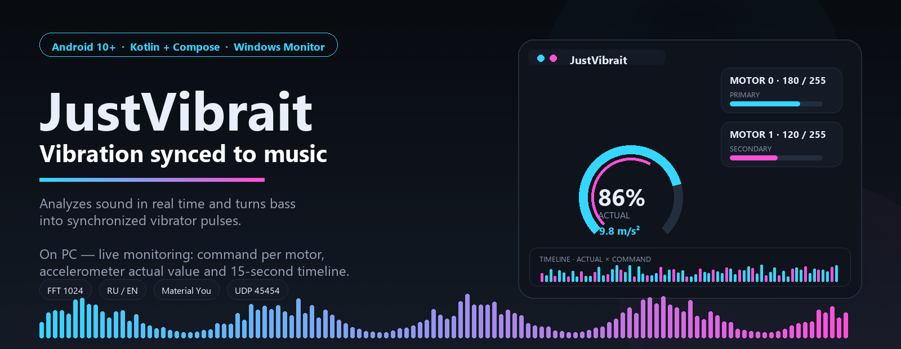

<br><br>

[](https://github.com/121kirillmorti/justvibrait/releases/tag/v1.2.0)
[](https://developer.android.com/)
[](https://kotlinlang.org/)
[](https://developer.android.com/jetpack/compose)
[](desktop/JustVibraitMotorMonitor/README.md)
[](LICENSE)

# JustVibrait

### Vibration synced to music

Analyzes sound in real time and turns bass into synchronized vibrator pulses.
On PC — live monitoring: command per motor, accelerometer actual value and 15-second timeline.

<br>

[](https://github.com/121kirillmorti/justvibrait/releases/tag/v1.2.0)
[](https://github.com/121kirillmorti/justvibrait/releases/tag/v1.2.0)
[](https://github.com/121kirillmorti/justvibrait)

<br>

**kotiktortiktech** · `com.kotiktortiktech.justvibrait` · English and Russian UI

<p>
  <a href="README.md">🇷🇺 Русский</a> · <strong>🇬🇧 English</strong>
</p>

</div>

<p align="center">
<a href="#-screenshots">📸 Screenshots</a> ·
<a href="#-features">✨ Features</a> ·
<a href="#-how-it-works">⚙️ How it works</a> ·
<a href="#-install">🚀 Install</a> ·
<a href="#-pc-monitor">🖥️ PC monitor</a> ·
<a href="#-building-from-source">🔨 Build</a>
</p>

---

## 📸 Screenshots

> Live screenshots from a device (dark Dynamic Color theme) and a real Windows monitor
> render in demo mode. Full gallery — in `docs/screenshots/`.
> The phone UI in screenshots is Russian (as captured); switch it to English in
> **Settings → Appearance → Language**. The PC monitor has a **RU / EN** button.

<div align="center">
  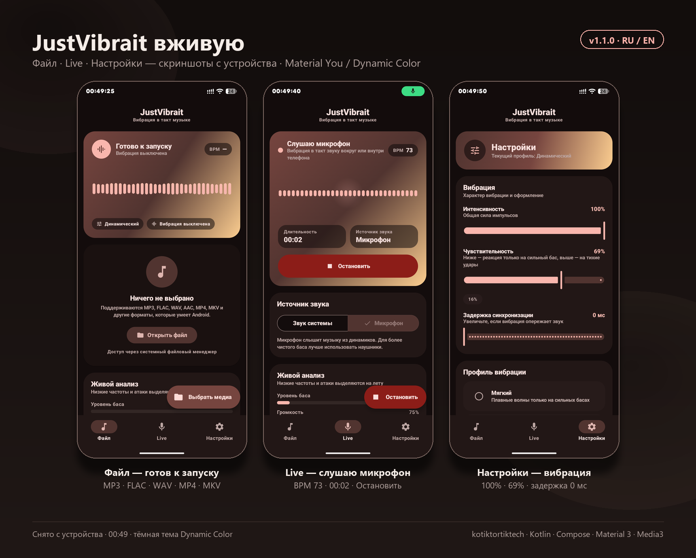
</div>

### 📱 Android

| 📁 File — ready to start | 🎙️ Live — listening to mic | ⚙️ Settings — vibration |
|:---:|:---:|:---:|
| 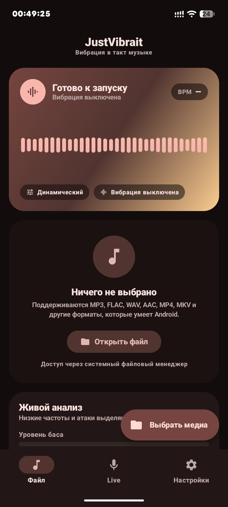 | 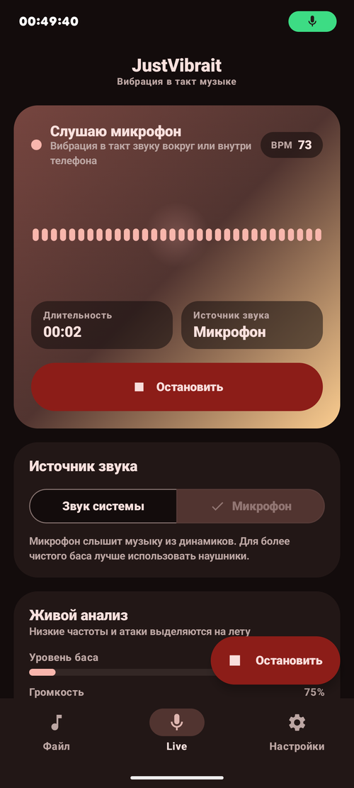 | 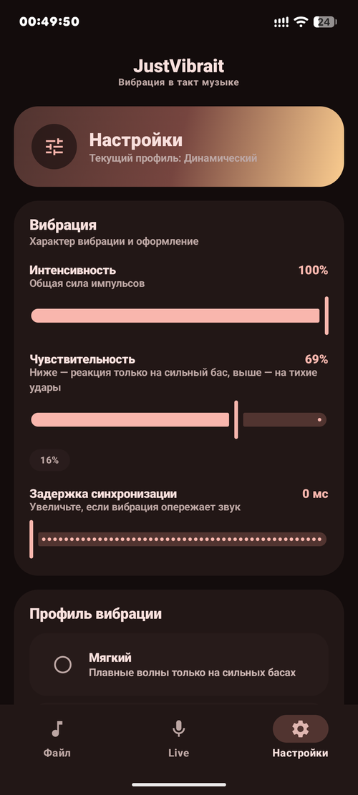 |
| “Nothing selected” → **Open file** (MP3/FLAC/WAV/MP4/MKV). Top: “Ready to start”. | Source “Microphone”, timer `00:02`, **Stop**. BPM 73, level 75%. | Intensity 100% · Sensitivity 69% · Delay 0 ms. |

| 🎨 Profile and theme | 🖥️ Debug — PC monitor | |
|:---:|:---:|:---:|
| 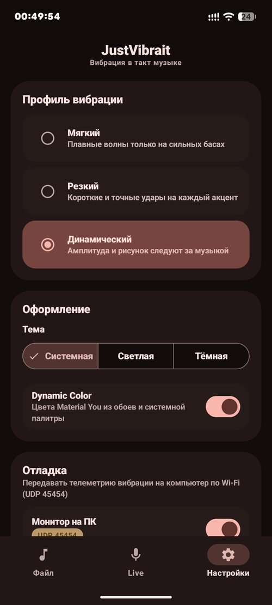 | 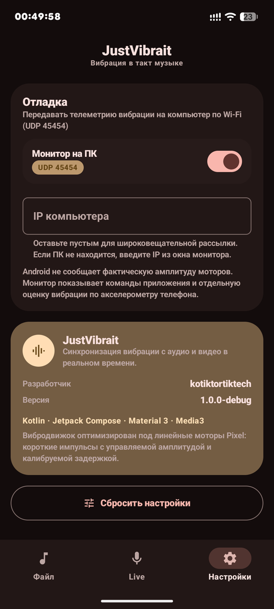 | |
| **Soft / Sharp / Dynamic** (selected). Theme: System / Light / Dark, Dynamic Color on. | **PC monitor** on (UDP 45454), IP field, accelerometer note. Below: About `kotiktortiktech`. | |

**What is on the screens:**
- Bottom navigation: **File · Live · Settings** (active highlighted).
- **File:** empty state + “Live analysis: low frequencies and attacks”.
- **Live:** “Listening to microphone” + “System sound / Microphone” switch.
- **Settings:** intensity / sensitivity / delay sliders, radio profiles, theme, Dynamic Color and “Debug”.

### 🎬 Preview video

Live monitor demo (Windows, 12 seconds, DEMO mode 126 BPM — gauge, motor cards and
timeline in motion). The GIF below autoplays; the full MP4 is in the release.

<div align="center">
  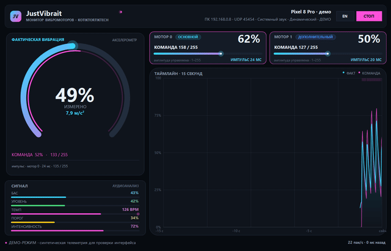
</div>

[](docs/preview.mp4)
[](https://github.com/121kirillmorti/justvibrait/releases/tag/v1.2.0)

### 🖥️ Windows monitor (demo)

Real renders in demo mode (synthetic telemetry, 126 BPM, two motors: primary and secondary).

| | |
|:---:|:---:|
| 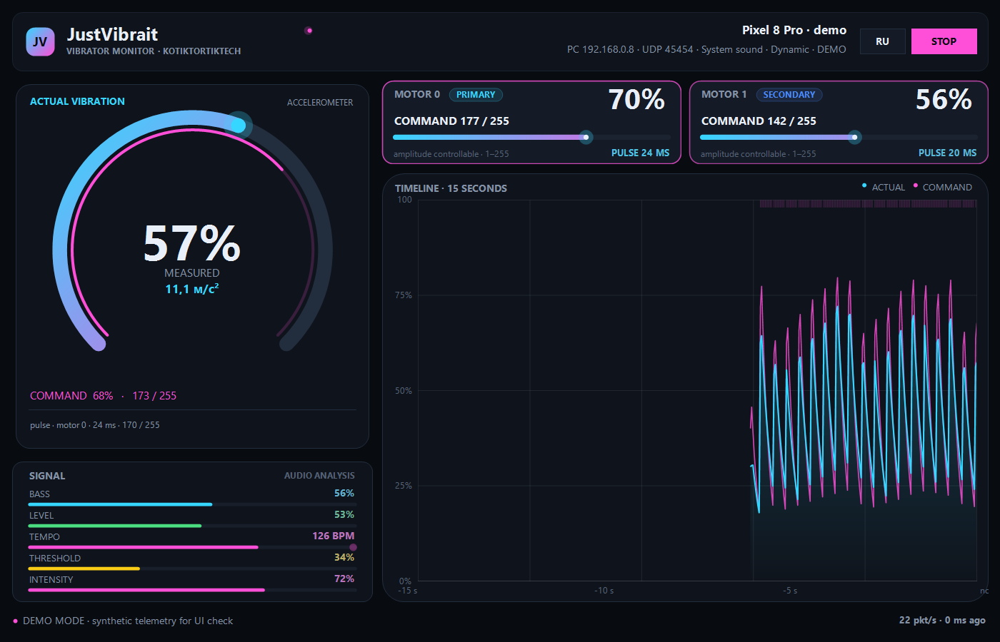 | |
| **Full monitor (English UI).** Left — actual vibration scale + signal panel. Right — motor cards and 15-second timeline (cyan — actual, pink — command). Switch language with **RU / EN** in the header. | |

| Actual scale | Motor commands |
|:---:|:---:|
| 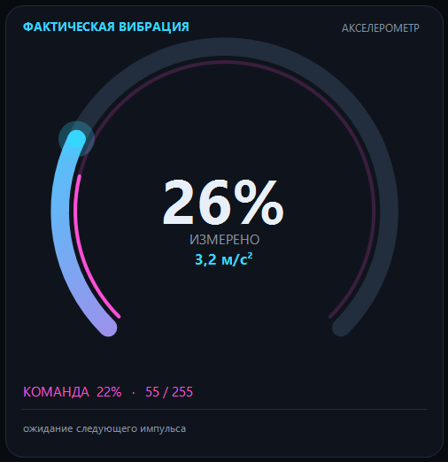 | 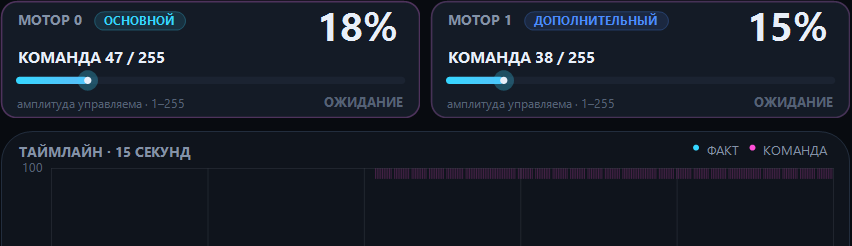 |

| 15-second timeline | Audio signal |
|:---:|:---:|
| 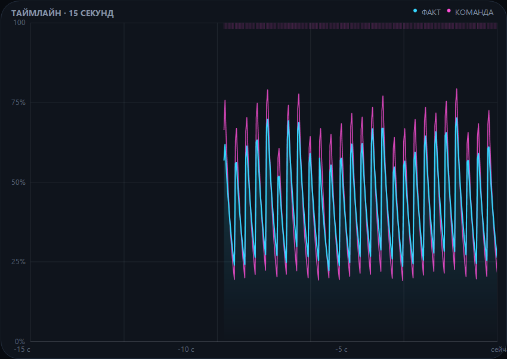 | 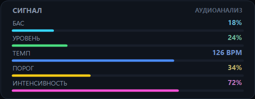 |

**How to read the monitor:**
- **ACTUAL VIBRATION (cyan)** — what reached the phone body (accelerometer, % and m/s²).
- **COMMAND (pink)** — what the app requested from the motor (amplitude 0–255 and duration).
- **MOTOR 0 / MOTOR 1** — one card per actuator seen by Android.
- **TIMELINE** — last 15 seconds: look right — that is “now”.

---

## ✨ Features

### 📁 Local files
- Pick audio or video via the system picker (`OpenDocument`) — no broad storage access.
- **Media3 / ExoPlayer**: MP3, FLAC, WAV, AAC, OGG, MP4, MKV and everything Android supports.
- PCM interception with a custom `AudioTapProcessor` — analysis follows the same timeline the user hears.
- Video: shared ExoPlayer timeline + `SurfaceView` — picture, sound and vibration stay in sync.
- Seek, pause, resume, clean vibration stop on pause / finish / error.

### 🎙️ Live mode
- **System sound** via `AudioPlaybackCapture` (Android 10+). On Android 14+ the `mediaProjection`-typed foreground service starts before `MediaProjection`.
- **Microphone**: `UNPROCESSED` with `MIC` fallback, session timer, level and BPM indicators.
- Background work: foreground service with notification and “Stop”, `PARTIAL_WAKE_LOCK`.

### 🎵 Analysis and vibration
- Custom FFT (1024 points, Hann, hop 512) without external DSP libraries.
- Bass band 28–170 Hz, level envelope, spectrum for visualization.
- Attack detector with adaptive threshold and median BPM tracking.
- Three profiles: **Soft** (smooth waves on strong bass), **Sharp** (short accurate hits on accents), **Dynamic** (amplitude and duration follow the music).
- Intensity, sensitivity and sync delay 0–250 ms.
- Tuned for Pixel linear motors: one-shot pulses with controllable amplitude, dedicated `HandlerThread`.

### 🎨 Interface
- Material 3 (dark / light / system theme), **Material You / Dynamic Color** on Android 12+.
- Cards, segments, sliders, FAB, bottom navigation and a live spectrum visualizer.
- Localization: Russian (default resources) and English (`values-en`). In-app switch
  under **Settings → Appearance → Language**: System / Русский / English (per-app locale,
  survives restart).

### 🖥️ PC debugging
- Optional UDP telemetry (port **45454**) for the desktop monitor.
- Per motor: id, command 0–255, duration; plus an independent accelerometer vibration estimate.
- Enable in **Settings → Debug → PC monitor** (off by default). PC IP from the monitor or broadcast.
- Windows dashboard: actual scale, motor cards, timeline, demo mode with two motors.
- Desktop monitor is bilingual too: auto-detects Windows language, remembers your choice,
  toggle with **RU / EN** in the header, force with `--lang=ru` / `--lang=en`.

---

## ⚙️ How it works

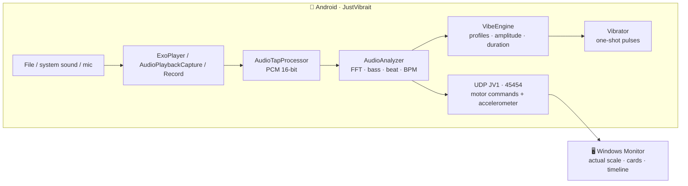

**Key point:** Android does not expose the actual motor amplitude.
So the monitor honestly separates **command** (what the app requested) from **actual**
(what the accelerometer really measured on the body).

---

## 🚀 Install

### 📱 Android app

| | |
|---|---|
| **Download APK** | [GitHub Release v1.2.0](https://github.com/121kirillmorti/justvibrait/releases/tag/v1.2.0) — `JustVibrait-1.2.0-release.apk` |
| **Install** | `adb install -r JustVibrait-1.2.0-release.apk` or install the file |
| **Check** | SHA-256 in the release + `apksigner verify --print-certs` (CN=kotiktortiktech) |

### 🖥️ PC monitor

| | |
|---|---|
| **Download** | [GitHub Release v1.2.0](https://github.com/121kirillmorti/justvibrait/releases/tag/v1.2.0) — `JustVibraitMotorMonitor-1.1.0-win.zip` |
| **Run** | Unzip and run `JustVibraitMotorMonitor.exe` |
| **Check without a phone** | **DEMO** button or `JustVibraitMotorMonitor.exe --demo` |
| **Language** | **RU / EN** button in the header, or `--lang=ru` / `--lang=en` |

---

## 📖 Usage

1. Open **File** and pick audio/video — or on the **Live** tab capture system sound / mic.
2. In settings pick a **profile** (Soft / Sharp / Dynamic), intensity and sensitivity.
3. Set **delay** 0–250 ms: increase it if vibration runs ahead of sound (Bluetooth/USB).
4. For debugging: **Settings → Debug → PC monitor** → enable and, if needed, enter the PC IP from the monitor window.
5. On PC: does the pink **command** match the cyan **actual**? If actual is weaker — the motor is not reaching the amplitude.

---

## 🖥️ PC monitor

A dark WinForms dashboard (`desktop/JustVibraitMotorMonitor`). Built with the system
`csc.exe` from .NET Framework 4.8 — no .NET SDK or Python needed.

### What it shows

- **ACTUAL VIBRATION** — accelerometer scale (% and m/s²) + the pink command arc.
- **Motor cards** — one per `VibratorManager` id: primary/secondary, amplitude controllability, command and duration.
- **TIMELINE** — 15 seconds: actual (cyan) and command (pink), beat ticks.
- **SIGNAL** — bass, level, tempo, threshold and intensity in real time.
- **DEMO** — 126 BPM synthetic data with two motors for UI checks (`--demo`).

### Quick start

1. Run the monitor; phone and PC on the same Wi-Fi.
2. On the phone: **Settings → Debug → PC monitor** → enable.
3. If Windows blocks UDP, run `allow-firewall.ps1` once as admin (UDP 45454 rule).
4. Press **DEMO** to verify the dashboard, then disable demo and play music on the phone.

> UDP packets are unencrypted and stay on the local network. Enable telemetry only on trusted networks.

---

## 🧱 Architecture

```
app/src/main/java/com/kotiktortiktech/justvibrait/
├── MainActivity.kt              # edge-to-edge Compose host
├── MainViewModel.kt             # settings, player, haptic engine
├── audio/                       # FFT, bass, attacks, BPM, PCM tap
├── data/                        # AppSettings (incl. AppLanguage) + SettingsRepository
├── debug/VibeTelemetry.kt       # UDP JV1, motor enumeration, accelerometer
├── media/LocalMediaManager.kt   # ExoPlayer + player state
├── service/LiveVibeService.kt   # foreground capture + vibration
├── ui/                          # Scaffold, navigation, screens, M3 theme
└── vibration/VibeEngine.kt      # profiles + one-shot vibration

desktop/JustVibraitMotorMonitor/
├── src/                         # TelemetryPacket, UDP, ArcGauge, MotorCard,
│                                # TimelineGraph, form, Chrome, Localization (RU/EN)
├── tests/SelfTest.cs            # JV1 parser + UDP-loopback self-tests
└── build.ps1                    # csc.exe → dist/*.exe
```

Local-mode data flow:

```
URI → ExoPlayer → AudioTapProcessor (PCM)
    → HandlerThread → AudioAnalyzer (FFT / bass / beat / BPM)
    → VibeEngine → Vibrator → StateFlow → Compose UI
```

---

## 🔌 JV1 telemetry

UDP **45454**, one tab-separated message per packet:

```
JV1  seq  uptimeMs  device  android  sdk  source  profile  intensity  threshold
     bass  level  bpm  beat  measured  measuredMs2  hasSensor  defaultMotorId  motors
```

`motors` — `id:hasAmplitude:amplitude:durationMs:isDefault;...`
Watch it in Wireshark. Short pulses are held for at least 140 ms; actual is peak-hold/decay.

---

## 🔨 Building from source

### Requirements

- JDK 17, Android LNG Platform 35 + Build-Tools 35.0.0, Gradle 8.9 (wrapper included)
- Windows 10/11 with .NET Framework 4.8 (for the monitor)

```powershell
$env:JAVA_HOME = "C:\dev\jdk17"
$env:ANDROID_HOME = "C:\AndroidSdk"

# Debug (applicationId with .debug suffix)
.\gradlew.bat :app:assembleDebug

# Release (signed APK)
.\gradlew.bat :app:assembleRelease

# PC monitor + self-tests
cd desktop\JustVibraitMotorMonitor
powershell -ExecutionPolicy Bypass -File .\build.ps1
```

### Signing

Release is signed with `keystore/justvibrait-release.jks` (alias `justvibrait`).
The key is **not in the repository** (see `.gitignore`) — create your own and point to it
in `app/build.gradle.kts` before building a release. For Google Play, replace the key and passwords.

Check:

```powershell
& "$env:ANDROID_HOME\build-tools\35.0.0\apksigner.bat" verify --verbose --print-certs dist\JustVibrait-1.2.0-release.apk
& "$env:ANDROID_HOME\build-tools\35.0.0\aapt2.exe" dump badging dist\JustVibrait-1.2.0-release.apk
```

---

## 🔐 Permissions

| Permission | Why |
|---|---|
| `VIBRATE` | Vibrator pulses |
| `RECORD_AUDIO` | Microphone and `AudioPlaybackCapture` |
| `INTERNET` | UDP telemetry to PC (only if debug is on) |
| `POST_NOTIFICATIONS` | Foreground service notification (Android 13+) |
| `FOREGROUND_SERVICE*` | Background audio/mic capture (Android 14+) |
| `WAKE_LOCK` | Stable work with the screen off |

File access is granted per document (`takePersistableUriPermission`).

---

## ⚠️ Limitations

- System sound capture is unavailable for apps that forbade `AudioPlaybackCapture` (some streamers) — use the microphone instead.
- On Android 14+ the screen/audio capture consent dialog appears at every start — a platform requirement.
- Vibration depends on the motor: linear actuators (Pixel) are the most accurate; ERM motors feel different.
- Sync delay depends on the audio output (Bluetooth/USB) — tune it in settings.
- BPM and attacks are heuristic: noise and live speech may trigger false positives.
- Android never exposes the actual motor amplitude — the monitor only measures the body via the accelerometer; each motor cannot be measured separately.

The app sends no data over the internet and contains no analytics. PC telemetry is opt-in.

---

## 📄 License

[MIT](LICENSE) © 2026 kotiktortiktech. Third-party libraries under their own licenses (AndroidX, Jetpack Compose, Media3).

<div align="center">

<br>

Made with 🎧 + 📳 by **kotiktortiktech**

⭐ [Star](https://github.com/121kirillmorti/justvibrait) · [All releases](https://github.com/121kirillmorti/justvibrait/releases)

</div>
