<div align="center">

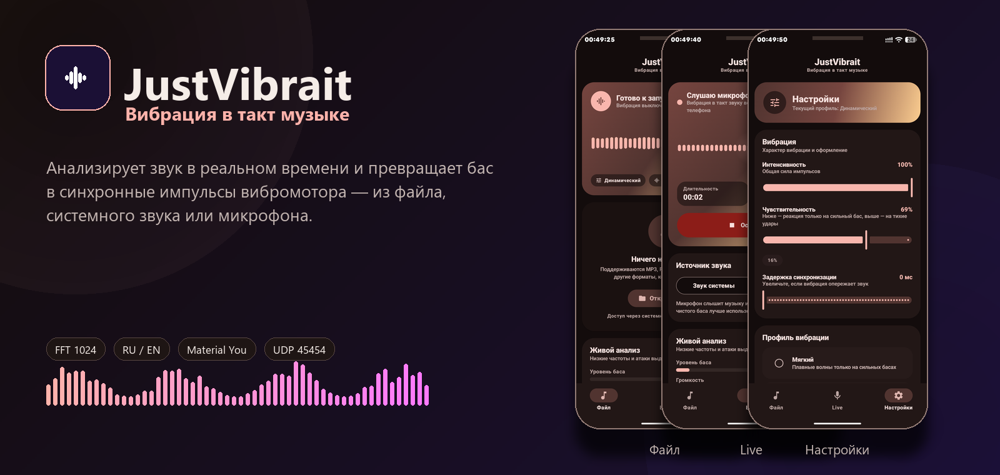

<br><br>

[](https://github.com/121kirillmorti/justvibrait/releases/tag/v1.2.0)
[](https://developer.android.com/)
[](https://kotlinlang.org/)
[](https://developer.android.com/jetpack/compose)
[](desktop/JustVibraitMotorMonitor/README.md)
[](LICENSE)

# JustVibrait

### Вибрация в такт музыке

Анализирует звук в реальном времени и превращает бас в синхронизированные импульсы вибромотора.
На ПК — живой мониторинг: команда каждому мотору, факт по акселерометру и таймлайн 15 секунд.

<br>

[](https://github.com/121kirillmorti/justvibrait/releases/tag/v1.2.0)
[](https://github.com/121kirillmorti/justvibrait/releases/tag/v1.2.0)
[](https://github.com/121kirillmorti/justvibrait)

<br>

**kotiktortiktech** · `com.kotiktortiktech.justvibrait` · Русский и English интерфейс

<p>
  <strong>🇷🇺 Русский</strong> · <a href="README.md">🇬🇧 English</a>
</p>

</div>

<p align="center">
<a href="#-скриншоты">📸 Скриншоты</a> ·
<a href="#-возможности">✨ Возможности</a> ·
<a href="#-как-это-работает">⚙️ Как это работает</a> ·
<a href="#-установка">🚀 Установка</a> ·
<a href="#-монитор-на-пк">🖥️ Монитор на ПК</a> ·
<a href="#-сборка-из-исходников">🔨 Сборка</a>
</p>

---

## 📸 Скриншоты

> Живые скриншоты Android-приложения с устройства (тёмная тема Dynamic Color) и
> реальный рендер монитора на Windows в демо-режиме. Вся галерея — в `docs/screenshots/`.

<div align="center">
  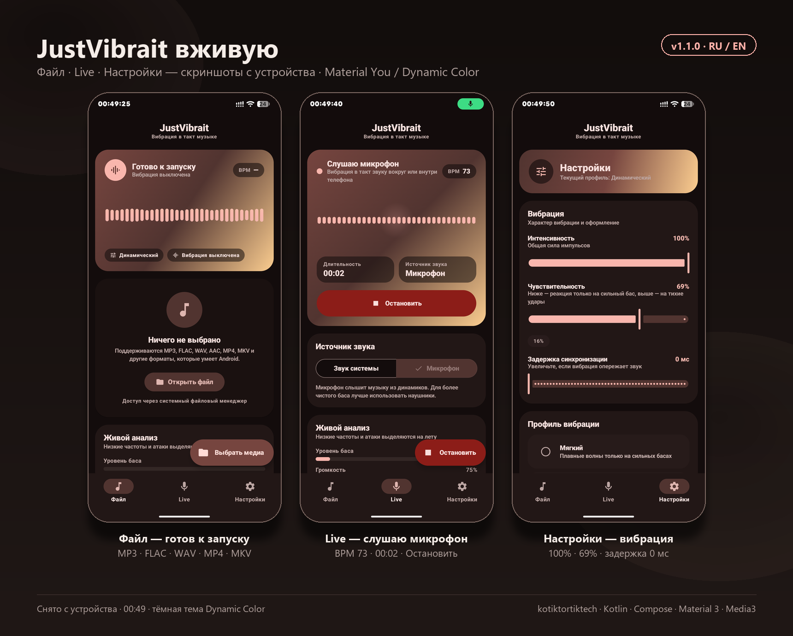
</div>

### 📱 Android

| 📁 Файл —готов к запуску | 🎙️ Live — слушаю микрофон | ⚙️ Настройки — вибрация |
|:---:|:---:|:---:|
| 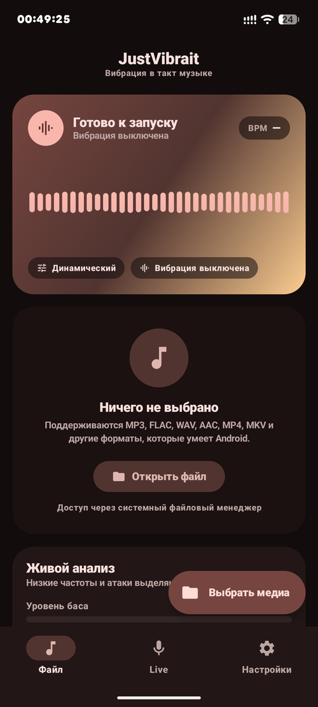 | 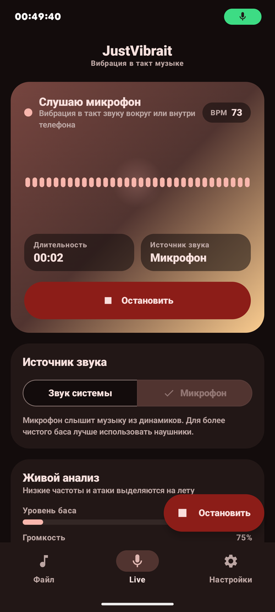 | 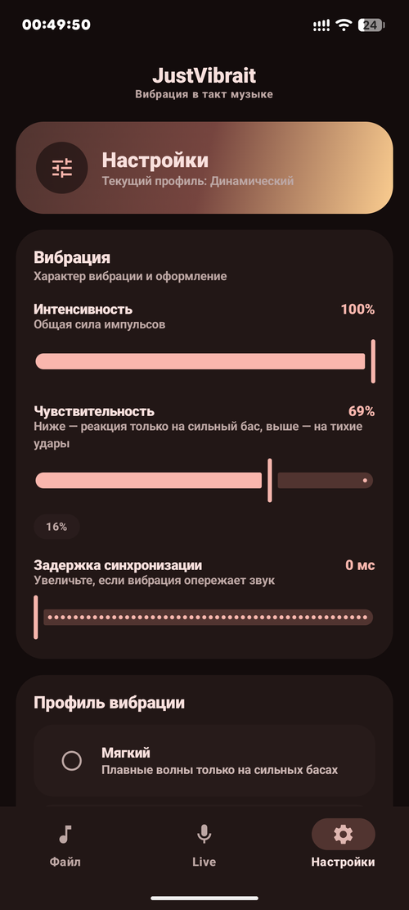 |
| «Ничего не выбрано» → **Открыть файл** (MP3/FLAC/WAV/MP4/MKV). Сверху — «Готово к запуску». | Источник «Микрофон», таймер `00:02`, **Остановить**. BPM 73, громкость 75%. | Интенсивность 100% · Чувствительность 69% · Задержка 0 мс. |

| 🎨 Профиль и тема | 🖥️ Отладка — монитор на ПК | |
|:---:|:---:|:---:|
| 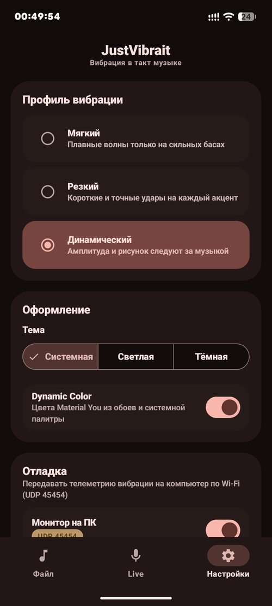 | 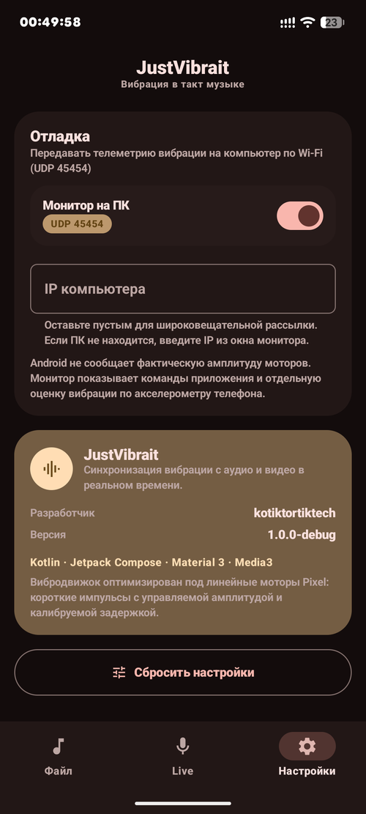 | |
| **Мягкий / Резкий / Динамический** (выбран). Тема: Системная/Светлая/Тёмная, Dynamic Color включён. | **Монитор на ПК** включён (UDP 45454), поле IP, объяснение про акселерометр. Снизу — About: `kotiktortiktech`. | |

**Что на экранах:**
- Навигация внизу: **Файл · Live · Настройки** (активная подсвечена).
- **Файл:** пустое состояние + «Живой анализ: низкие частоты и атаки».
- **Live:** «Слушаю микрофон» + переключатель «Звук системы / Микрофон».
- **Настройки:** слайдеры интенсивности/чувствительности/задержки, радиопрофили, тема, Dynamic Color и «Отладка».

### 🖥️ Монитор на Windows (демо)

Реальные рендеры приложения в демо-режиме (синтетическая телеметрия, 126 BPM, два мотора: основной и дополнительный). Русский UI ниже, английский — справа. Переключить язык кнопкой **RU / EN** в шапке.

| | |
|:---:|:---:|
| 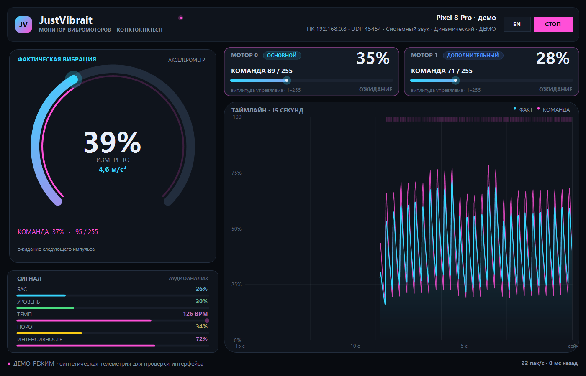 | 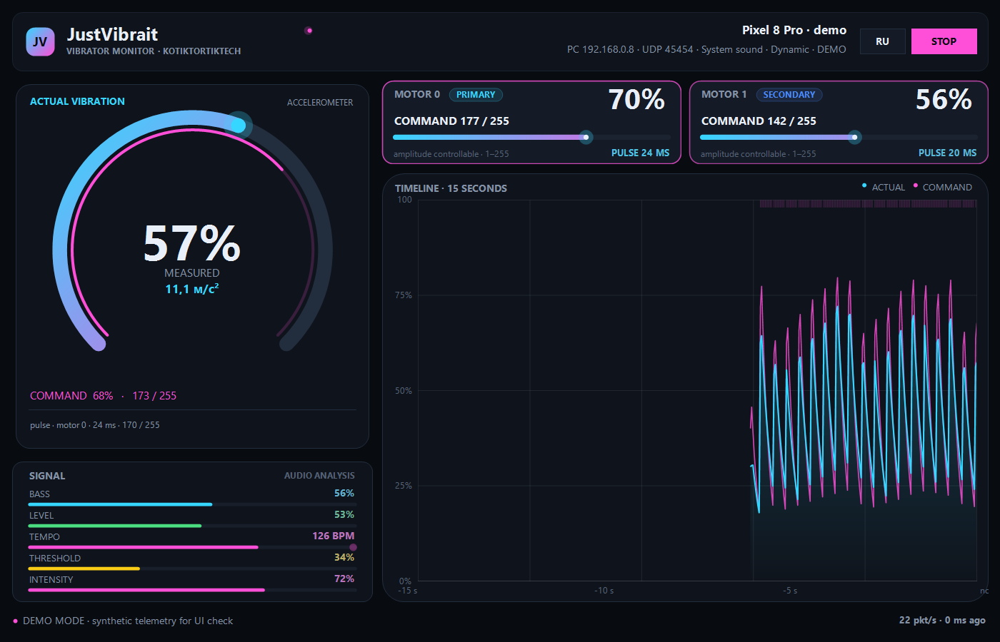 |
| **Русский UI.** Слева — шкала фактической вибрации по акселерометру и панель сигнала. Справа — карточки моторов и таймлайн 15 секунд (голубой — факт, розовый — команда). | **English UI.** Same screen with the RU / EN toggle in the header. |

| Шкала факта | Команды моторов |
|:---:|:---:|
| 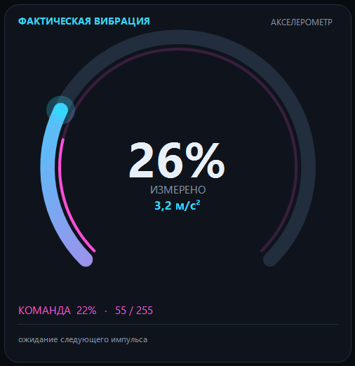 | 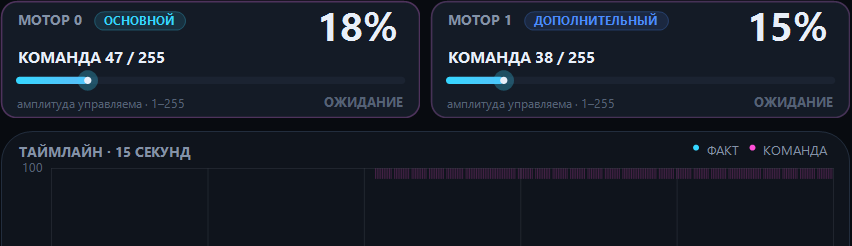 |

| Таймлайн 15 секунд | Аудио-сигнал |
|:---:|:---:|
| 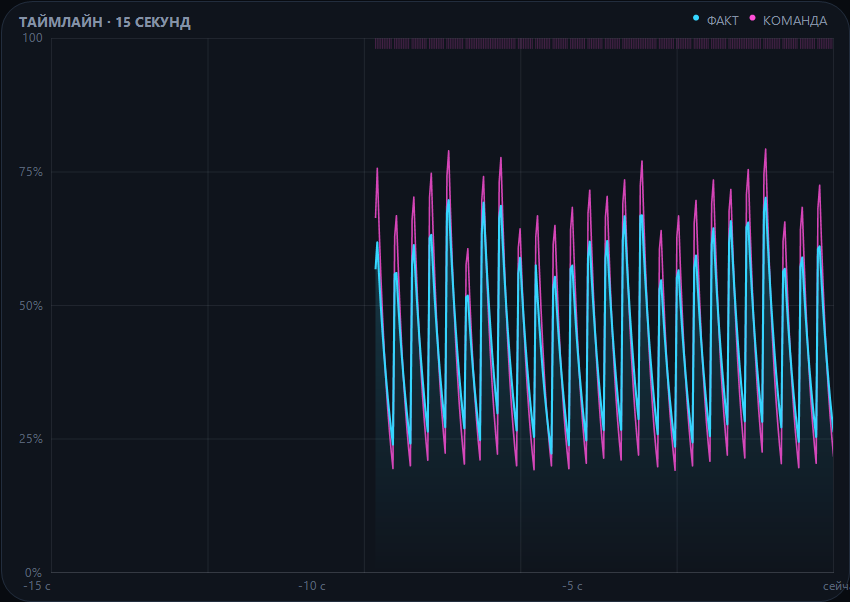 | 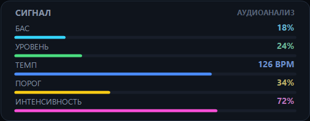 |

**Как читать монитор:**
- **ФАКТИЧЕСКАЯ ВИБРАЦИЯ (голубой)** — то, что дошло до корпуса телефона (акселерометр, % и м/с²).
- **КОМАНДА (розовый)** — то, что приложение запросило у мотора (амплитуда 0–255 и длительность).
- **МОТОР 0 / МОТОР 1** — отдельная карточка на каждый актуатор, увиденный Android.
- **ТАЙМЛАЙН** — последние 15 секунд: двигайте взгляд вправо — там «сейчас».

---

## ✨ Возможности

### 📁 Локальные файлы
- Выбор аудио/видео через системный picker (`OpenDocument`) — без доступа ко всей памяти.
- **Media3 / ExoPlayer**: MP3, FLAC, WAV, AAC, OGG, MP4, MKV и всё, что умеет Android.
- Перехват PCM-потока собственным `AudioTapProcessor` — анализ по тому же таймлайну, что слышит пользователь.
- Видео: общий таймлайн ExoPlayer + `SurfaceView` — картинка, звук и вибрация не расходятся.
- Перемотка, пауза, продолжение, корректная остановка вибрации при паузе/завершении/ошибке.

### 🎙️ Живой режим
- **Системный звук** через `AudioPlaybackCapture` (Android 10+). На Android 14+ соблюдён порядок запуска foreground-сервиса с типом `mediaProjection`.
- **Микрофон**: `UNPROCESSED` с fallback на `MIC`, таймер сессии, индикаторы уровня и BPM.
- Фоновая работа: foreground-сервис с уведомлением и «Стоп», `PARTIAL_WAKE_LOCK`.

### 🎵 Анализ и вибрация
- Собственный FFT (1024 точки, Ханн, hop 512) без внешних DSP-библиотек.
- Полоса баса 28–170 Гц, огибающая уровня, спектр для визуализации.
- Детектор атак с адаптивным порогом и медианным трекингом BPM.
- Три профиля: **Мягкий** (плавные волны на сильных басах), **Резкий** (короткие удары на акценты), **Динамический** (амплитуда и длительность следуют за музыкой).
- Интенсивность, чувствительность и задержка синхронизации 0–250 мс.
- Оптимизация под линейные моторы Pixel: one-shot импульсы с управляемой амплитудой, отдельный `HandlerThread`.

### 🎨 Интерфейс
- Material 3 (тёмная/светлая/системная тема), **Material You / Dynamic Color** на Android 12+.
- Карточки, сегменты, слайдеры, FAB, нижняя навигация и живой визуализатор спектра.
- Локализация: русский и английский. В приложении — **Настройки → Оформление → Язык**: Системный / Русский / English (per-app locale, сохраняется после перезапуска).

### 🖥️ Отладка на ПК
- Опциональная UDP-телеметрия (порт **45454**) для настольного монитора.
- Каждому мотору: id, команда 0–255, длительность; плюс независимая оценка вибрации по акселерометру.
- Вкл. в **Настройки → Отладка → Монитор на ПК** (по умолчанию выключено). IP из монитора или широковещание.
- Windows-дашборд: шкала факта, карточки моторов, таймлайн, демо-режим с двумя моторами.
- Монитор двуязычный: определяют язык Windows, запоминает выбор, переключается кнопкой **RU / EN** (`--lang=ru` / `--lang=en`).

---

## ⚙️ Как это работает

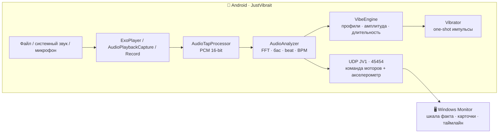

**Ключевой момент:** Android не отдаёт приложениям фактическую амплитуду мотора.
Поэтому монитор честно различает **команду** (что попросило приложение) и **факт**
(что реально измерил акселерометр корпуса).

---

## 🚀 Установка

### 📱 Android-приложение

| | |
|---|---|
| **Скачать APK** | [GitHub Release v1.2.0](https://github.com/121kirillmorti/justvibrait/releases/tag/v1.2.0) — `JustVibrait-1.2.0-release.apk` |
| **Установить** | `adb install -r JustVibrait-1.2.0-release.apk` или установка из файла |
| **Проверка** | SHA-256 в релизе + `apksigner verify --print-certs` (CN=kotiktortiktech) |

### 🖥️ Монитор для ПК

| | |
|---|---|
| **Скачать** | [GitHub Release v1.2.0](https://github.com/121kirillmorti/justvibrait/releases/tag/v1.2.0) — `JustVibraitMotorMonitor-1.1.0-win.zip` |
| **Запуск** | Распакуйте и запустите `JustVibraitMotorMonitor.exe` |
| **Проверка без телефона** | Кнопка **ДЕМО** или `JustVibraitMotorMonitor.exe --demo` |
| **Язык** | Кнопка **RU / EN** в шапке или `--lang=ru` / `--lang=en` |

---

## 📖 Использование

1. Откройте **Файл** и выберите аудио/видео — или на вкладке **Live** захватите системный звук / микрофон.
2. В настройках подберите **профиль** (Мягкий / Резкий / Динамический), интенсивность и чувствительность.
3. Настройте **задержку** 0–250 мс: увеличьте, если вибрация опережает звук (Bluetooth/USB).
4. Для отладки: **Настройки → Отладка → Монитор на ПК** → включите и, при необходимости, введите IP ПК из окна монитора.
5. Смотрите на ПК: совпадает ли розовая **команда** с голубым **фактом**? Если факт слабее — мотор не тянет амплитуду.

---

## 🖥️ Монитор на ПК

Тёмный дашборд на WinForms (`desktop/JustVibraitMotorMonitor`). Собирается системным
`csc.exe` из .NET Framework 4.8 — без .NET SDK и Python.

### Что показывает

- **ФАКТИЧЕСКАЯ ВИБРАЦИЯ** — шкала по акселерометру (% и м/с²) + розовая дуга команды.
- **Карточки моторов** — по одной на каждый `VibratorManager`-id: основной/дополнительный, управляемость амплитуды, команда и длительность.
- **ТАЙМЛАЙН** — 15 секунд истории: факт (голубой) и команда (розовый), метки бита.
- **СИГНАЛ** — бас, уровень, темп, порог и интенсивность в реальном времени.
- **ДЕМО** — синтетика с двумя моторами (126 BPM) для проверки интерфейса.

### Быстрый запуск

1. Запустите монитор, подключите телефон и ПК к одной Wi-Fi сети.
2. На телефоне: **Настройки → Отладка → Монитор на ПК** → включите.
3. Если Windows блокирует UDP, один раз запустите `allow-firewall.ps1` от администратора.
4. Нажмите **ДЕМО** — убедитесь, что дашборд живой, затем выключите демо и включите музыку на телефоне.

> UDP-пакеты не шифруются и идут только по локальной сети. Включайте телеметрию в доверенной сети.

---

## 🧱 Архитектура

```
app/src/main/java/com/kotiktortiktech/justvibrait/
├── MainActivity.kt              # edge-to-edge Compose-хост
├── MainViewModel.kt             # настройки, плеер, вибродвижок
├── audio/                       # FFT, бас, атаки, BPM, PCM-tap
├── data/                        # AppSettings + SettingsRepository
├── debug/VibeTelemetry.kt       # UDP JV1, перебор моторов, акселерометр
├── media/LocalMediaManager.kt   # ExoPlayer + состояние плеера
├── service/LiveVibeService.kt   # foreground-захват и вибрация
├── ui/                          # Scaffold, навигация, экраны, тема M3
└── vibration/VibeEngine.kt      # профили и one-shot вибрация

desktop/JustVibraitMotorMonitor/
├── src/                         # TelemetryPacket, UDP, ArcGauge, MotorCard,
│                                # TimelineGraph, форма, Chrome
├── tests/SelfTest.cs            # парсер JV1 + UDP-loopback self-тесты
└── build.ps1                    # csc.exe → dist/*.exe
```

Поток локального режима:

```
URI → ExoPlayer → AudioTapProcessor (PCM)
    → HandlerThread → AudioAnalyzer (FFT / бас / beat / BPM)
    → VibeEngine → Vibrator → StateFlow → Compose UI
```

---

## 🔌 Телеметрия JV1

UDP **45454**, одно таб-разделённое сообщение на пакет:

```
JV1  seq  uptimeMs  device  android  sdk  source  profile  intensity  threshold
     bass  level  bpm  beat  measured  measuredMs2  hasSensor  defaultMotorId  motors
```

`motors` — `id:hasAmplitude:amplitude:durationMs:isDefault;...`
Пакет удобно смотреть в Wireshark. Короткие импульсы удерживаются минимум 140 мс, факт — peak-hold/decay.

---

## 🔨 Сборка из исходников

### Требования

- JDK 17, Android SDK Platform 35 + Build-Tools 35.0.0, Gradle 8.9 (wrapper включён)
- Windows 10/11 с .NET Framework 4.8 (для монитора)

```powershell
$env:JAVA_HOME = "C:\dev\jdk17"
$env:ANDROID_HOME = "C:\AndroidSdk"

# Debug (applicationId с суффиксом .debug)
.\gradlew.bat :app:assembleDebug

# Release (подписанный APK)
.\gradlew.bat :app:assembleRelease

# Монитор на ПК + self-тесты
cd desktop\JustVibraitMotorMonitor
powershell -ExecutionPolicy Bypass -File .\build.ps1
```

### Подпись

Release подписывается ключом `keystore/justvibrait-release.jks` (alias `justvibrait`).
Ключ **не хранится в репозитории** (см. `.gitignore`) — перед сборкой release создайте
свой и укажите пути в `app/build.gradle.kts`. Для публикации в Google Play замените ключ и пароли.

Проверка:

```powershell
& "$env:ANDROID_HOME\build-tools\35.0.0\apksigner.bat" verify --verbose --print-certs dist\JustVibrait-1.2.0-release.apk
& "$env:ANDROID_HOME\build-tools\35.0.0\aapt2.exe" dump badging dist\JustVibrait-1.2.0-release.apk
```

---

## 🔐 Разрешения

| Разрешение | Зачем |
|---|---|
| `VIBRATE` | Импульсы вибромотора |
| `RECORD_AUDIO` | Микрофон и `AudioPlaybackCapture` |
| `INTERNET` | UDP-телеметрия на ПК (только если включена отладка) |
| `POST_NOTIFICATIONS` | Уведомление foreground-сервиса (Android 13+) |
| `FOREGROUND_SERVICE*` | Фоновый захват звука/микрофона (Android 14+) |
| `WAKE_LOCK` | Стабильная работа при выключенном экране |

Доступ к файлам — только на выбранный документ (`takePersistableUriPermission`).

---

## ⚠️ Ограничения

- Захват системного звука недоступен для приложений, запретивших `AudioPlaybackCapture` (отдельные стриминги) — тогда микрофон.
- На Android 14+ согласие на захват экрана/звука спрашивается при каждом запуске — требование платформы.
- Вибрация зависит от мотора: на линейных актуаторах (Pixel) точнее всего, на ERM ощущается иначе.
- Задержка синхронизации зависит от аудиовыхода (Bluetooth/USB) — настраивается в приложении.
- BPM и атаки эвристические: на шуме и живой речи возможны ложные срабатывания.
- Фактическую амплитуду моторов Android не отдаёт — монитор измеряет только корпус акселерометром, а каждый мотор отдельно измерить нельзя.

Приложение не передаёт данные в интернет и не содержит аналитики. Телеметрия на ПК — только по вашему включению.

---

## 📄 Лицензия

[MIT](LICENSE) © 2026 kotiktortiktech. Сторонние библиотеки — по их лицензиям (AndroidX, Jetpack Compose, Media3).

<div align="center">

<br>

Made with 🎧 + 📳 by **kotiktortiktech**

⭐ [Поставить звезду](https://github.com/121kirillmorti/justvibrait) · [Все релизы](https://github.com/121kirillmorti/justvibrait/releases)

</div>
